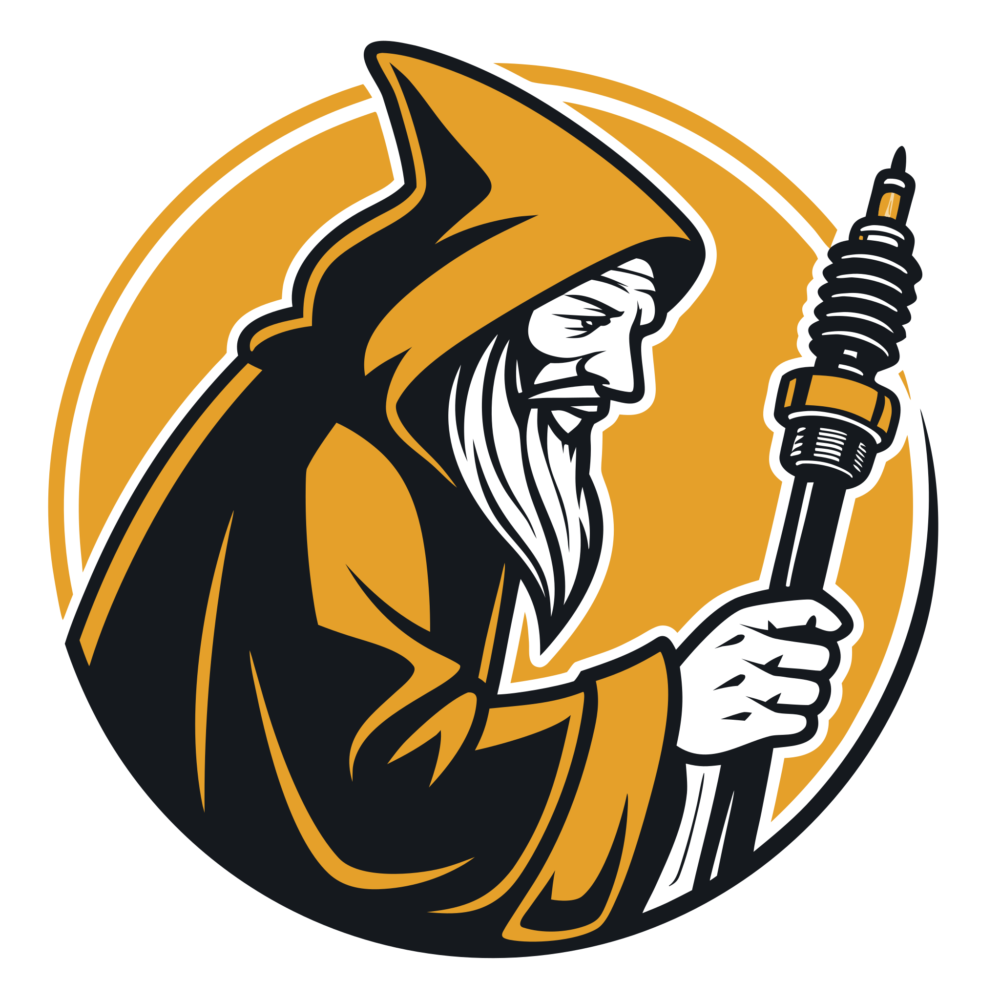
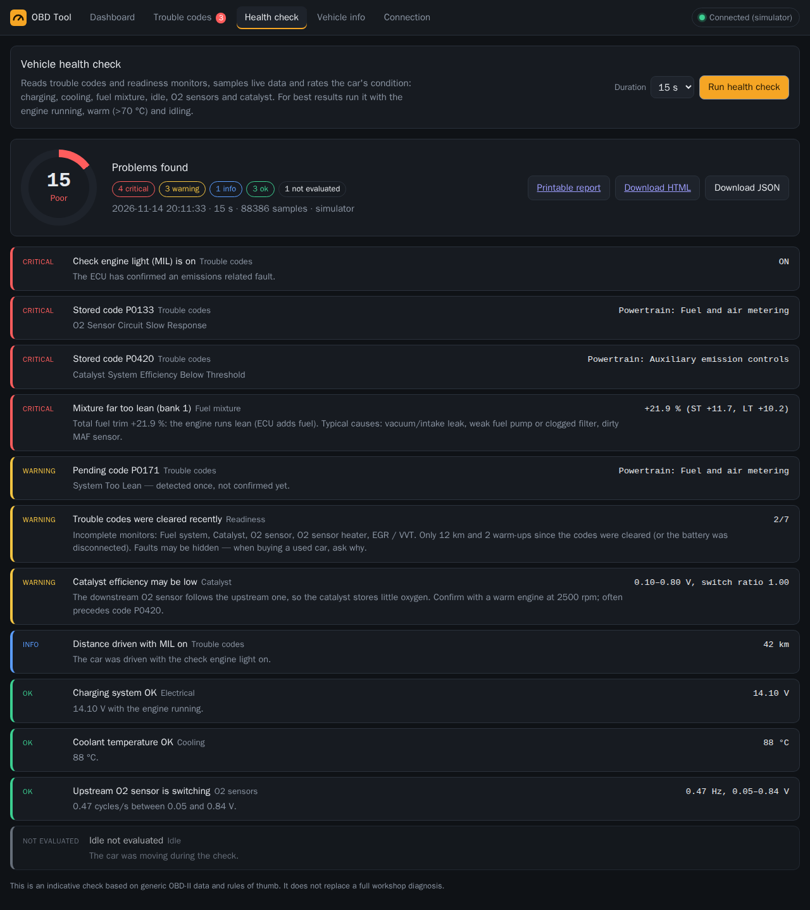
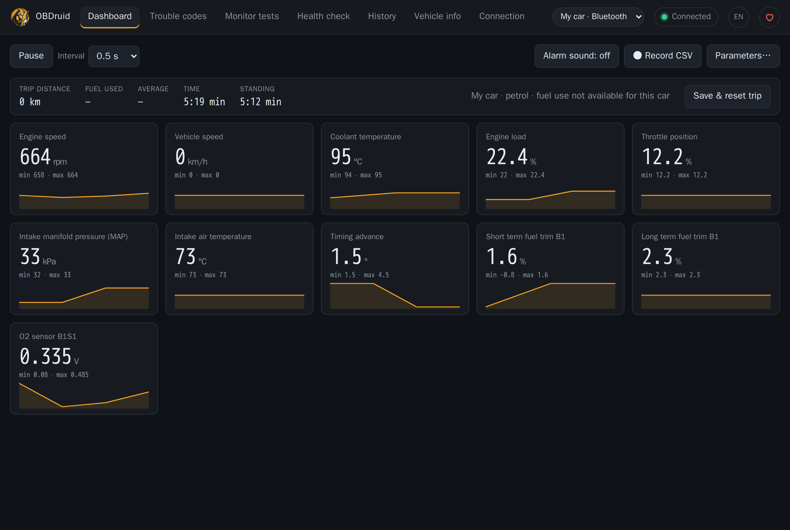
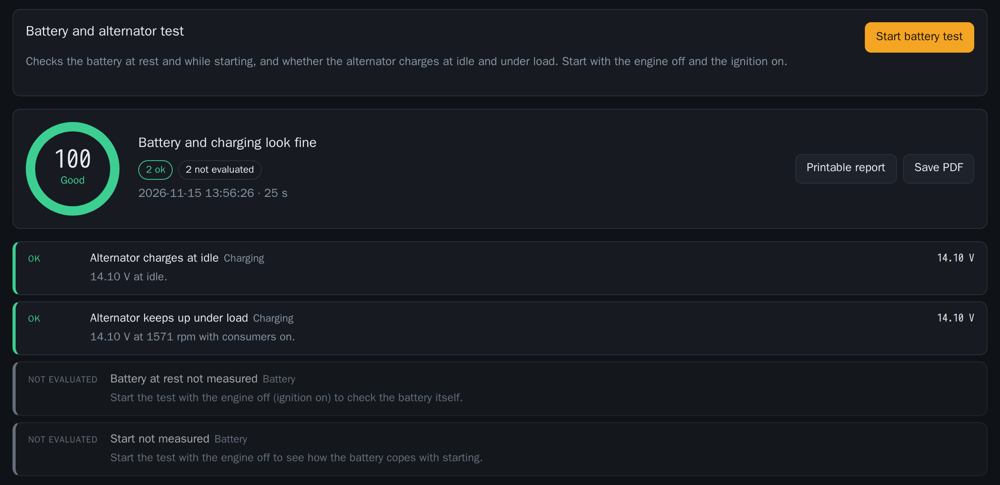
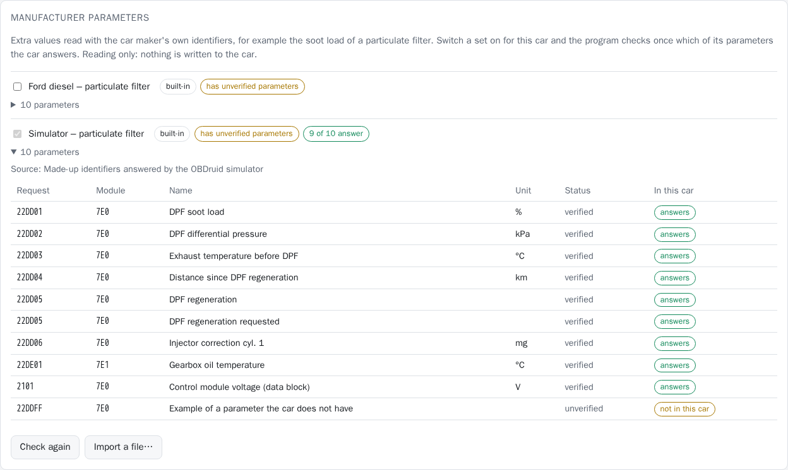
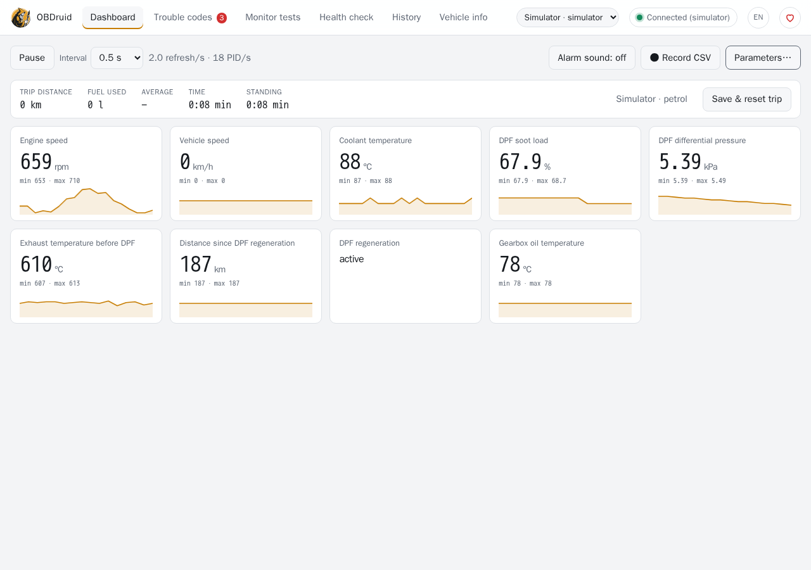
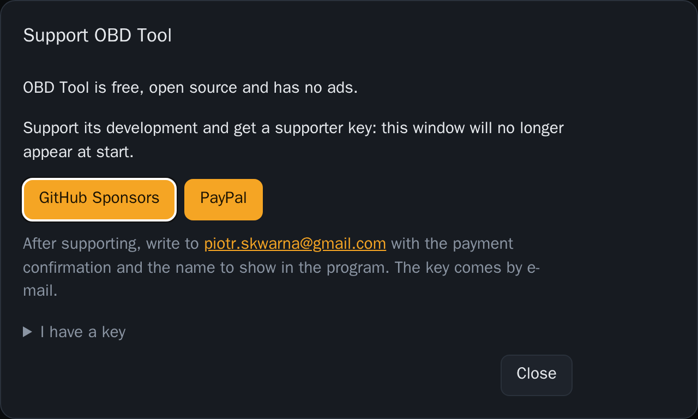

<p align="center">
  
</p>

<h1 align="center">OBDruid</h1>

<p align="center">
  <b>Open-source OBD-II workshop tool</b> – reads your car's signs and tells what ails it.<br>
  <a href="https://github.com/spidero/obdruid/actions/workflows/tests.yml"></a>
  · by Piotr Skwarna · GPL-2.0-or-later
</p>

A small OBD-II workshop tool in Python: live data, reading and clearing trouble codes,
freeze frame, on-board monitor tests (mode 06), readiness monitors, fuel consumption and a
**vehicle health check** with a 0–100 score. One core, three front ends:

- **CLI** – `obdruid info | live | dtc | tests | clear | health | battery | history | pids | did | ports | supporter`
- **Web UI** – `obdruid web`, open it from a laptop or a phone
- **Desktop GUI** – `obdruid gui`, the same UI in a native window (pywebview)

The web UI and the desktop GUI are available in **English and Polish** – switch with the `EN`/`PL`
button in the top bar.

A built-in **ELM327 simulator** (`--sim`) lets you run everything without a car.


| Health check | Trouble codes | Vehicle info | Phone |
|---|---|---|---|
|  |  |  |  |

| Gauges and alarms | Monitor tests (mode 06) | Freeze frame | Before / after comparison |
|---|---|---|---|
|  |  |  |  |

> Formerly *OBD Tool* (`obd-tool`). The old command still works as an alias, and the data folder
> `~/.local/share/obd-tool` is moved to `~/.local/share/obdruid` automatically.

## Quick start

1. **Install** (Linux, Python 3.11+; details in [Install](#install)):
   ```bash
   git clone https://github.com/spidero/obdruid.git && cd obdruid
   python3 -m venv --system-site-packages .venv && .venv/bin/pip install -e ".[gui]"
   ```
2. **Try it without a car** – the built-in simulator plays a car with a few trouble codes:
   ```bash
   .venv/bin/obdruid --sim gui
   ```
3. **Connect a car:** plug an ELM327 adapter into the OBD-II socket (under the dashboard) and into
   USB, turn the ignition on (or start the engine) and run `.venv/bin/obdruid gui`. The adapter is
   found automatically; `obdruid ports` lists the serial ports if it is not. Bluetooth or Wi-Fi adapter?
   See [Bluetooth and Wi-Fi adapters](#bluetooth-and-wi-fi-adapters).
4. **First checks:** the *Trouble codes* tab shows stored and pending codes with descriptions,
   *Health check* (engine warm and idling) gives a 0–100 score with explanations.

No adapter at your desk? Plug it into a Raspberry/Orange Pi in the car, run `obdruid web --host 0.0.0.0`
there and open the UI from a phone or laptop, or use `obdruid gui --remote <pi-address>`.

At start the app shows a short *Support OBDruid* window – see [Support](#support).

## Supported adapters

| Adapter | Status | Notes |
|---|---|---|
| Vgate vLinker FS (USB) | **tested** | FTDI serial, ELM327 v2.3 compatible, 115200 baud. Reference adapter. |
| Other USB ELM327 / STN adapters (OBDLink SX/EX, vLinker FD/MC USB) | should work | Anything that shows up as a serial port and speaks the ELM327 command set. |
| Bluetooth ELM327, classic and dual-mode (e.g. "OBDII") | **tested** | Port `rfcomm://MAC` (Linux) – no pairing tool or `rfcomm bind` needed. Tested with the common blue **"ELM 327 MINI Interface"** (v2.1 clone): about 7 PID/s. |
| Bluetooth LE ELM327 (e.g. "OBDBLE", vLinker MC+, iOS-style adapters) | **tested** | Port `ble://MAC` (Linux). Dual-mode ELM327 v2.1 clone: about 6 PID/s. |
| Cheap ELM327 v1.5 / v2.1 clones | should work | Often unreliable or slow; try `--slow` if the connection fails. |
| Wi-Fi ELM327 adapters | should work | Port `socket://IP:PORT`, usually `socket://192.168.0.10:35000`. Not tested yet. |

Cars: anything with a standard OBD-II / EOBD socket (petrol from about 2001, diesel from about
2004 in the EU). Only the engine ECU's generic emissions data is read – no ABS, airbag or
gearbox modules. Mode 06 needs a CAN protocol. The same table is shown in the Connection tab.

### Bluetooth and Wi-Fi adapters

Wireless adapters are used through a port address instead of a serial device:

| Adapter | Port | Notes |
|---|---|---|
| Bluetooth (classic, SPP) | `rfcomm://AA:BB:CC:DD:EE:FF` | Linux. The channel is found automatically; force one with `rfcomm://MAC/2`. |
| Bluetooth LE | `ble://AA:BB:CC:DD:EE:FF` | Linux. Works with dual-mode adapters too; add `?type=random` for random addresses. |
| Wi-Fi | `socket://192.168.0.10:35000` | Join the adapter's Wi-Fi network first. |



Find the address with a scan – in the web UI (*Connection → Find Bluetooth adapters*, then click the
adapter) or in a terminal:

```bash
obdruid ports --scan                               # serial ports + nearby Bluetooth adapters
obdruid -p ble://81:23:45:67:89:BA info            # use the address as the port
obdruid -p rfcomm://01:23:45:67:89:BA live
```

Several cars? Each vehicle profile remembers its adapter: pick the car in the switcher at the top
and OBDruid connects to it (e.g. a diesel on USB and a petrol car on Bluetooth). A car that does not
report its VIN is recognised by the adapter it was last connected through.

Tips:

- Many cheap adapters show up twice, e.g. **OBDII** (classic) and **OBDBLE** (LE): both work; classic is
  usually a little faster.
- An adapter talks to one device at a time – disconnect phone apps first.
- No pairing and no root are needed on Linux. If the scan finds nothing, check that Bluetooth is on
  (`bluetoothctl show`) and the ignition is on (many adapters sleep with the ignition off).
- Bluetooth is slower than USB (cheap clones: about 6–7 parameters per second instead of 30–60).

## Tested hardware

- Adapters: Vgate **vLinker FS** USB (FTDI, ELM327 v2.3 compatible), 115200 baud; blue **"ELM 327 MINI
  Interface"** Bluetooth clone (ELM327 v2.1, dual-mode: "OBDII" classic + "OBDBLE" LE)
- Cars:
  - petrol engine, ISO 15765-4 CAN 11 bit / 500 kbit, single engine ECU (7E8), 33 live parameters
  - Ford diesel with DPF, ISO 15765-4 CAN 11 bit / 500 kbit, VIN reported (16 characters),
    31 live parameters incl. fuel rail pressure, EGR, oil temperature, fuel level
- Host: Orange Pi 3B, Debian 12 (aarch64), Python 3.11; also any Linux PC

Any ELM327 compatible adapter (USB, Bluetooth via `rfcomm`) should work through
[python-OBD](https://github.com/brendan-w/python-OBD).

## Install

### Without Python: ready-to-run downloads

From version 0.6.0 every [release](https://github.com/spidero/obdruid/releases/latest) has builds that
need no Python and no installation:

| System | File | How to start |
|---|---|---|
| Windows 10/11 (64-bit) | `OBDruid-<version>-windows-x64.zip` | unpack, double-click `OBDruid.exe` |
| Linux (64-bit PC) | `OBDruid-<version>-x86_64.AppImage` | `chmod +x OBDruid-*.AppImage`, then run it |
| Linux on ARM (Raspberry Pi, Orange Pi, 64-bit) | `OBDruid-<version>-aarch64.AppImage` | same as above |

- **Windows:** the app opens in its own window (Edge WebView2, part of Windows 10/11). The builds are not
  code-signed yet, so SmartScreen may say *Windows protected your PC* – choose *More info → Run anyway*.
  `obdruid-cli.exe` in the same folder is the command line tool: `obdruid-cli.exe --sim info`.
  A USB adapter shows up as a COM port (`obdruid-cli.exe ports`); data is kept in `%APPDATA%\OBDruid`.
- **Linux AppImage:** started without arguments it opens the interface in a window, using what your
  system already has (the AppImage itself stays small): GTK with WebKit of the system Python
  (`python3-gi`, `gir1.2-webkit2-4.1` – often there on GNOME desktops), otherwise Chrome, Chromium, Edge,
  Brave or Vivaldi as an app window, otherwise a tab of your default browser (the program then quits by
  itself a few minutes after you close the tab). `OBDRUID_WINDOW=gtk|chromium|browser` picks one.
  With arguments it is the `obdruid` command:
  `./OBDruid-*.AppImage --sim info`, `./OBDruid-*.AppImage web --host 0.0.0.0`.
  No FUSE on your system? Add `--appimage-extract-and-run` as the first argument.
  Serial adapters need access to the port: `sudo usermod -aG dialout $USER`, then log in again.
- Try it without a car: tick *Simulator* in the *Connection* tab, or start with `--sim`.
- **Code signing (Windows):** free code signing provided by [SignPath.io](https://about.signpath.io/),
  certificate by [SignPath Foundation](https://signpath.org/) – from the first release after the project is
  approved; see the [code signing policy](CODE_SIGNING_POLICY.md), which also holds the
  [privacy policy](CODE_SIGNING_POLICY.md#privacy-policy) (in short: no data leaves your computer).
- Not in these builds yet: Bluetooth LE on Windows (use a USB adapter, or pair a classic Bluetooth
  adapter and use its COM port).

### With Python

From a release (no git needed) – download the wheel from the
[latest release](https://github.com/spidero/obdruid/releases/latest) and install it with pipx:

```bash
pipx install --system-site-packages "obdruid-0.7.1-py3-none-any.whl[gui]"   # or [web] without the window
```

From source:

```bash
git clone https://github.com/spidero/obdruid.git
cd obdruid
python3 -m venv --system-site-packages .venv
.venv/bin/pip install -e ".[gui]"        # or ".[web]" without the desktop window
```

System packages (Debian/Ubuntu):

```bash
sudo apt install python3-venv                       # virtual environments
sudo apt install python3-gi gir1.2-gtk-3.0 gir1.2-webkit2-4.1   # only for `obdruid gui`
sudo usermod -aG dialout $USER                      # access to /dev/ttyUSB*, log in again
```

`--system-site-packages` is needed for the GUI because the GTK bindings (`gi`) come from
the system, not from pip. Without them `obdruid gui` falls back to the web browser.

## Usage

```bash
obdruid ports                       # find the adapter
obdruid -p /dev/ttyUSB0 info        # adapter, protocol, VIN, MIL, readiness monitors
obdruid -p /dev/ttyUSB0 live        # live data (Ctrl+C to stop)
obdruid live RPM SPEED COOLANT_TEMP -i 0.25 --csv drive.csv
obdruid pids                        # parameters supported by the car
obdruid live RPM FUEL_FLOW FUEL_ECONOMY TRIP_DISTANCE   # calculated fuel use and trip values
obdruid did 22F190                  # one manufacturer identifier, raw answer (read only)
obdruid dtc                         # stored, pending and permanent codes + freeze frame
obdruid dtc --json
obdruid tests                       # on-board monitor test results (mode 06)
obdruid clear                       # clear codes (asks for confirmation, saves a backup first)
obdruid history                     # saved health reports, pre-clear backups and trips
obdruid health                      # 30 s health check, score 0-100
obdruid health -d 60 --html report.html --json
obdruid web                         # web UI on http://localhost:8090
obdruid web --host 0.0.0.0          # ...reachable from the local network
obdruid gui                         # desktop window
obdruid gui --remote raspberrypi.local   # desktop window showing another machine's web UI
obdruid --sim live                  # anything above, against the simulator
```

Options can also be set with environment variables: `OBD_PORT`, `OBD_BAUD`,
`OBD_PROTOCOL`, `OBD_SIM=1`, `OBD_WEB_HOST`, `OBD_WEB_PORT`, `OBD_REMOTE`.
Use the stable `/dev/serial/by-id/...` path instead of `/dev/ttyUSB0` when possible.

### Desktop window for a remote adapter

When the adapter is plugged into another machine (for example a Raspberry/Orange Pi in the car
running `obdruid web --host 0.0.0.0`), the desktop app can show that machine instead of starting
its own server:

```bash
obdruid gui --remote 192.168.1.50          # http:// and port 8090 are added
obdruid gui --remote https://obd.example.com/   # a full URL is used as is
```

The app checks that an OBDruid server answers at the address before opening the window.

### Health check

Run it with the engine running, warm (>70 °C) and idling. The check reads trouble codes,
readiness monitors and counters, samples live data (the last third only the O2 sensors, at a
higher rate) and applies rules of thumb for petrol engines:

| Area | What is checked |
|---|---|
| Trouble codes | MIL, stored and pending codes, distance driven with MIL on |
| Readiness | incomplete monitors; few km / warm-ups since clearing = "codes cleared recently" |
| Electrical | charging voltage with the engine running (13.4–14.8 V), resting battery voltage |
| Cooling | overheating (>104 / >108 °C), thermostat stuck open (<75 °C after 15 min) |
| Fuel mixture | short + long term fuel trim per bank (±10 % warning, ±20 % critical) |
| Idle | rpm stability while standing, high idle, intake vacuum (MAP) at idle |
| O2 sensors | upstream sensor switching rate and amplitude |
| Catalyst | downstream sensor steady vs. following the upstream one |

Each finding is OK / info / warning / critical, or "not evaluated" when a precondition
(engine running, engine warm, car standing) is not met. The score starts at 100 and loses
points per finding; any critical finding caps it at 59 (Poor), any warning at 84 (Fair).
The report can be saved as **PDF** (*Save PDF* opens the print window – choose “Save as PDF”),
downloaded as HTML or JSON. It is an indicative check,
not a replacement for a workshop diagnosis.

Try it without a car using simulator faults:

```bash
obdruid --sim --sim-no-codes health -d 15                       # healthy car
obdruid --sim --sim-fault lean --sim-fault catalyst health -d 15
```

Faults: `lean`, `rich`, `charging`, `overheat`, `rough_idle`, `lazy_o2`, `catalyst`, `cleared`.

### Battery and alternator test

A guided test in the *Health check* tab (or `obdruid battery`): start with the **engine off and the
ignition on** and follow the steps.

| Step | What is measured | Healthy |
|---|---|---|
| Engine off | battery voltage at rest → state of charge | 12.4 V or more |
| Start the engine | lowest voltage while cranking | stays above 10 V |
| Idle | charging voltage and how steady it is | 13.4–14.8 V |
| ~2000 rpm, lights + rear heater + blower on | charging under load | stays above 13.4 V |

The result says in plain words what is wrong – a discharged or weak battery, an alternator that does not
charge or cannot keep up, or a faulty regulator (overcharging, fluctuating voltage). Started with the
engine running, only the charging steps are done. The voltage is measured by the adapter at the OBD socket;
results are saved in the history and can be printed or saved as PDF.



### Freeze frame, permanent codes and monitor tests

- **Freeze frame** (mode 02): the engine conditions the ECU recorded when it detected the fault –
  rpm, speed, load, coolant temperature, fuel trims. Most cars keep one frame, and clearing erases it.
- **Permanent codes** (mode 0A): confirmed codes that a scan tool cannot clear. They go away by
  themselves once the ECU has seen the fault fixed.
- **Monitor tests** (mode 06): the ECU's own test results for the catalyst, O2 sensors, EGR, misfire
  counters… with its limits. Each result is rated `pass`, `near limit` (less than 15 % headroom to a
  single limit, or within 10 % of the edge of an allowed window) or `fail`, so a part that is wearing
  out shows up before a trouble code does. Test names above `$80` are manufacturer defined and shown
  by number. The health check uses all three.

### Dashboard, fuel consumption and trips

Every tile can be a number with a history line, a gauge or a large chart, with its own scale and
warning/alarm limits (coloured tile, optional beep). Drag tiles to reorder them. The layout is stored
on the server per vehicle, so the phone and the laptop show the same dashboard.

Calculated parameters: fuel flow (l/h), instant and average consumption (l/100 km), trip distance,
fuel used, time and average speed. Fuel flow comes from the ECU's fuel rate (PID 5E) when the car
reports it, otherwise it is estimated from the mass air flow for petrol and LPG (set the fuel in the
vehicle profile). It is an estimate – a little high while coasting and at full load. Diesels need
PID 5E. “Save & reset trip” keeps the trip in the history.

### Manufacturer parameters (PID sets)

Standard OBD-II does not show everything the car knows – the soot load of a diesel particulate
filter, for example, is only available under the car maker's own identifiers (UDS service 22, or
service 21 on e.g. Hyundai/Kia and Toyota).
OBDruid reads such values from **PID set files**, so a new car needs a text file, not new code.

- *Vehicle info → Manufacturer parameters*: switch a set on for the car. The program asks once for
  every parameter of the set ("probing") and keeps the ones the car answers; they then appear among
  the normal parameters – dashboard tiles, charts, alarms, CSV, `obdruid live`.
- **Reading only.** A set may use the reading services 22, 21 and 01 – nothing else. Requests that
  write to or control a module (2E, 2F, 31, session changes...) are refused when the file is loaded.
- Works on cars with 11-bit CAN, with the modules at `7E0`–`7E7` (engine, transmission...).
- Parameters marked **unverified** come from lists that were not confirmed on a real car: check the
  values before you rely on them.
- Try it without a car: `obdruid --sim web` has a demo set (a particulate filter), and
  `--sim-fault dpf_regen` / `dpf_full` show a regeneration and a full filter.

| Sets for the car | On the dashboard |
|---|---|
|  |  |

Sets that come with the program:

| Set | For | Status |
|---|---|---|
| Ford diesel – particulate filter | soot load, distance since regeneration, regeneration status, differential pressure, exhaust temperatures | **unverified** candidates converted from [OBDb/Ford](https://github.com/OBDb/Ford) (CC BY-SA 4.0); not yet confirmed on a car |
| Hyundai i30 (2007–2012) petrol – engine | oil temperature, commanded idle speed, MAP sensor voltage, injection times (service 21 blocks) | **unverified** candidates converted from [OBDb/Hyundai-i30](https://github.com/OBDb/Hyundai-i30) (CC BY-SA 4.0) |
| VW group (VW, Audi, Seat, Škoda, Cupra) – engine and gearbox | fuel pressures (low and high), boost pressure, oil level and temperature, misfires, camshaft adjustment, DSG clutch temperatures | **unverified**, 80 parameters merged from 69 OBDb models (CC BY-SA 4.0) |
| Toyota – engine and gearbox | service 21 blocks: fuel trims, air-fuel sensors, catalyst temperatures, knock, throttle, oil and gearbox temperatures (also Peugeot 107 / Citroën C1) | **unverified**, 80 parameters from 40 OBDb models (CC BY-SA 4.0) |
| Hyundai / Kia – engine and gearbox | injection times, misfires per cylinder, knock retard, gearbox oil temperature, current gear | **unverified**, 80 parameters from 56 OBDb models (CC BY-SA 4.0) |
| Renault / Dacia – engine and gearbox | coolant and oil temperature, boost and manifold pressure, particulate filter pressure, knock per cylinder, oil dilution, gearbox temperature | **unverified**, 80 parameters from 15 OBDb models (CC BY-SA 4.0) |
| Simulator – particulate filter | demo for `--sim` | made-up identifiers |

The make-wide sets are merged over many models and engines, mostly from recent years: a given car
answers only a part of them, and probing a set takes a little while (it asks for each identifier
once). There is no set for Peugeot/Citroën/Opel engines yet – OBDb has hardly any data for their
engine modules. Other makes can be converted with
[`tools/obdb_convert.py`](tools/obdb_convert.py) (needs only Python):

```bash
python tools/obdb_convert.py --fetch Mazda --id mazda --name "Mazda – engine" --wmi JM1,JMZ -o mazda.toml
```

and the file imported in the *Manufacturer parameters* card. `--labels-pl tools/obdb-labels-pl.json`
adds the Polish labels that are already translated.

Your own set is a TOML file, imported in the same card (or put in `~/.local/share/obdruid/pidsets/`):

```toml
format = 1
id = "my-car-dpf"                # lower case letters, digits and "-"
name = "My car – DPF"
source = "where the identifiers come from"

[match]                          # optional: marks the set as "matches this car"
wmi = ["WF0"]                    # start of the VIN
fuel = "diesel"
years = [2006, 2014]

[[params]]
key = "DPF_SOOT"
label = "DPF soot load"
label_pl = "Zapełnienie DPF sadzą"   # optional Polish label
request = "22XXXX"               # service 22 + identifier (or 21XX, 01XX)
header = "7E0"                   # module address, default 7E0 (engine)
formula = "(A*256+B)/100"        # A, B, C... Z, AA, AB... = data bytes of the answer
unit = "%"
decimals = 1
interval = 5                     # seconds between reads (optional)
min = 0                          # gauge scale and alert limits (optional)
max = 120
warn_high = 80
alarm_high = 95
status = "unverified"            # or "verified" once checked on a real car
role = "dpf_soot"                # optional: what the value means for the health check
```

Formulas use the same letters as Torque's custom PIDs: numbers, `+ - * / // %`, brackets, bit
operations (`& | ^ << >>`) and `signed(A)`, `signed(A,B)`, `bit(A,n)`, `abs()`, `min()`, `max()`.
A state instead of a number: `map = { 0 = "idle", 1 = "active" }`. With a `role` – `dpf_soot` (soot
load in %), `dpf_distance` (km since the last regeneration) or `dpf_regen` (regeneration running) – the
health check also judges the particulate filter: filling up from 80 %, full from 100 %, a long distance
without a regeneration, a regeneration in progress (indicative limits). Several parameters may share one
identifier (different bytes or bits) – it is asked for only once per read.

`obdruid did 22XXXX [--header 7E1]` (or `obdruid did 21XX`) shows the raw bytes of one identifier, with the letters the
formula will see – handy for checking a definition. A complete example is
[`simulator.toml`](src/obdruid/core/pidsets/simulator.toml). Found identifiers that work on your
car? Please share them in an issue or a pull request.

### Vehicle profiles and history

Each vehicle has a profile (name, VIN, fuel, notes), its own dashboard layout and a history of health
reports, pre-clear backups and trips – see the History tab or `obdruid history`. Cars that report a
VIN are recognised automatically. A car that does not report its VIN (common on older cars) is
recognised by its fingerprint – the OBD protocol, the modules that answer and the standard PIDs it
supports – so two such cars on one adapter keep separate profiles. The simulator always uses its own
“Simulator” profile. Tick two
health reports to compare them, for example before and after a repair. Files are plain JSON in
`~/.local/share/obdruid` (override with `OBDRUID_DATA`).

### Languages

The `EN`/`PL` button in the top bar switches the web UI (and the printable health report) between
English and Polish; the choice is remembered in the browser, and a Polish browser starts in Polish.
English texts are the keys of one dictionary, `src/obdruid/web/static/pl.json`, used by both the
browser and the server (`obdruid/i18n.py`). Health findings are stored as templates with parameters,
so saved reports follow the current language. To add a language, copy `pl.json`, translate it and add
its code to `LANGUAGES` in `i18n.py` and to the button in `app.js`.

**Trouble code descriptions** are translated too: all ~1800 generic descriptions are built from a parts
dictionary (`src/obdruid/core/dtc_pl.json`: component names, fault kinds, prefixes), for example
*Fuel Rail Pressure Sensor Circuit Low* → *Czujnik ciśnienia paliwa w listwie – obwód: sygnał niski*.
Not translated: the command line and the API messages.

### Clearing trouble codes

Clearing (mode 04) erases stored and pending codes and freeze frame data **and resets
the readiness monitors**. Until they complete again (a few drive cycles) the car may fail
an emissions inspection. The CLI asks for confirmation (`--yes` skips it), the web UI
requires ticking a checkbox, and the API refuses requests without `"confirm": true`.
Before clearing, the codes and the freeze frame are saved to the vehicle history.

### Web API

| Method | Path | Description |
|---|---|---|
| GET | `/api/state` | connection state |
| POST | `/api/connect` | `{"port", "baudrate", "protocol", "simulate"}` |
| POST | `/api/disconnect` | |
| GET | `/api/ports` | serial ports |
| GET | `/api/info` | adapter, VIN, MIL, readiness |
| GET | `/api/params` | supported live parameters |
| GET | `/api/read?keys=RPM,SPEED` | one-shot read |
| GET | `/api/dtc` | stored, pending and permanent codes + freeze frame |
| GET | `/api/freeze-frame` | freeze frame (mode 02) |
| GET | `/api/monitors` | monitor test results (mode 06) |
| POST | `/api/dtc/clear` | `{"confirm": true}`; saves a backup to the history first |
| GET, PUT | `/api/dashboard` | dashboard layout of the active vehicle |
| GET | `/api/trip` | trip summary; `POST /api/trip/reset` saves and resets it |
| GET, POST | `/api/vehicles` | vehicle profiles; `PUT`/`DELETE /api/vehicles/{id}`, `POST .../activate` |
| GET | `/api/history` | history records (`?kind=health\|dtc-backup\|trip`); `GET`/`DELETE /api/history/{id}`, `GET .../report.html` |
| GET, POST | `/api/pidsets` | manufacturer PID sets of the active vehicle; `POST {"text": "<TOML>"}` imports a file, `DELETE /api/pidsets/{id}` removes it |
| PUT | `/api/pidsets/enabled` | `{"ids": [...]}` – sets switched on for the active vehicle; `POST /api/pidsets/probe` asks the car again |
| GET | `/api/about` | version, links, supported adapters |
| WS | `/ws/health` | send `{"duration": 30}`, receive progress and the report |
| GET | `/api/health/last` | last health report (JSON) |
| GET | `/api/health/report.html` | last health report (HTML, `?download=1`) |
| WS | `/ws/live` | send `{"keys": [...], "interval": 0.5}`, receive readings |

The web server has no authentication. Keep it on `127.0.0.1` (default) or a trusted
network.

### Install it on your phone

The web UI is an installable app (PWA): open it on the phone and use the browser menu.

- **iPhone/iPad (Safari):** *Share → Add to Home Screen*. Works over plain `http://`.
- **Android (Chrome):** *⋮ → Add to Home screen* creates a shortcut. A full install (own window,
  offline shell) needs HTTPS – start the server with a certificate:

  ```bash
  openssl req -x509 -newkey rsa:2048 -nodes -days 3650 -subj "/CN=obdruid" \
    -keyout obdruid-key.pem -out obdruid-cert.pem
  obdruid web --host 0.0.0.0 --ssl-cert obdruid-cert.pem --ssl-key obdruid-key.pem
  ```

  With a self-signed certificate the browser shows a warning once; accept it for your own device.

### Connection lost?

The server reconnects by itself: after a lost link (ignition off, Bluetooth out of range) it retries
after 5 s, then every 15 s and 30 s until the car answers again or you press *Disconnect*. The top bar
shows *Reconnecting…*. A server started before the ignition was on connects once the car wakes up.

### Run as a service (Raspberry/Orange Pi)

`deploy/obdruid-web.service` starts the web UI on boot, listening on all interfaces. It is an
example for the user `pi` with the repo in `/home/pi/obdruid` – edit `User`, the paths and
optionally `OBD_PORT` first:

```bash
sudo cp deploy/obdruid-web.service /etc/systemd/system/
sudo systemctl enable --now obdruid-web
```

## Development

```bash
.venv/bin/pip install -e ".[dev]"
.venv/bin/pytest
```

Without a local venv, run the tests in Docker:

```bash
docker run --rm -v "$PWD":/app -w /app python:3.12-slim \
  sh -c 'pip install -q -e ".[dev]" && pytest -q'
```

Layout:

```
src/obdruid/
  core/session.py     thread-safe OBD session on top of python-OBD
  core/simulator.py   ELM327 emulator on a pseudo terminal
  core/pids.py        parameter catalogue (labels, units, groups)
  core/dtc.py         DTC encoding and descriptions
  core/diag.py        freeze frame (02), monitor tests (06), permanent codes (0A)
  core/trip.py        fuel consumption and trip computer
  core/storage.py     vehicle profiles, dashboard layouts, history (JSON files)
  core/health.py      health check: sampling + rules (pure evaluate())
  core/report_html.py printable HTML report
  about.py            project links, supported adapters
  i18n.py             translations shared with the browser (web/static/pl.json)
  cli.py              Typer CLI
  web/server.py       FastAPI + WebSocket
  web/static/         UI (plain HTML/CSS/JS, no CDN – works offline)
  gui.py              pywebview window
tests/                pytest, all against the simulator
```

## Roadmap

- Docker image + compose for the Orange Pi (adapter passed with `devices:`)
- MQTT publishing for Home Assistant
- Manufacturer PID sets for real cars (verified on the car), import of Torque lists
- Windows build and a single-file Linux build (AppImage)

## Support

OBDruid is free, open source and has no ads.
If it saved you a trip to the workshop, please support its development:

- [GitHub Sponsors](https://github.com/sponsors/spidero)
- [PayPal](https://paypal.me/spidero)



**Supporter key.** The web UI and the desktop app show a *Support OBDruid* window at every start.
Supporters receive a personal key that hides it and shows *Licensed to: your name* in *About*.
To get one, support the project and write to [piotr.skwarna@gmail.com](mailto:piotr.skwarna@gmail.com?subject=OBD%20Tool%20supporter%20key)
with the payment confirmation and the name to show in the program; the key comes by e-mail.
Activate the key in that window (*I have a key*), in *About*, or in a terminal:

```bash
obdruid supporter OBDT1-...      # activate (on a Pi: once for all browsers)
obdruid supporter                # show the current key
obdruid supporter --remove
```

Keys are checked offline – no account and no internet connection needed. A star on GitHub,
a bug report or telling a friend help too.

## Contributing

Bug reports, car/adapter reports, translations and code are welcome – see
[CONTRIBUTING.md](CONTRIBUTING.md) and the [Code of Conduct](CODE_OF_CONDUCT.md).
Security problems: [SECURITY.md](SECURITY.md).

## License

Copyright (C) 2026 Piotr Skwarna

OBDruid is free software: you can redistribute it and/or modify it under the terms of the
GNU General Public License as published by the Free Software Foundation, either
[version 2 of the License](LICENSE), or (at your option) any later version
(SPDX: `GPL-2.0-or-later`).

PID set files converted from community databases keep the license of their source, stated at the
top of each file: the Ford, Hyundai, VW group, Toyota, Hyundai/Kia and Renault/Dacia sets in
[`core/pidsets`](src/obdruid/core/pidsets/) are derived from [OBDb](https://github.com/OBDb) and licensed
CC BY-SA 4.0, and so is every file written by `tools/obdb_convert.py`.

This program is distributed in the hope that it will be useful, but WITHOUT ANY WARRANTY;
without even the implied warranty of MERCHANTABILITY or FITNESS FOR A PARTICULAR PURPOSE.
See the GNU General Public License for more details.

OBDruid uses [python-OBD](https://github.com/brendan-w/python-OBD) (GPL-2.0-only); bundled builds
that include it, such as a standalone Windows `.exe`, are therefore distributed under GPL version 2.
The other dependencies (pyserial, Typer, Rich, FastAPI, Uvicorn, pywebview) use MIT or BSD licenses.
