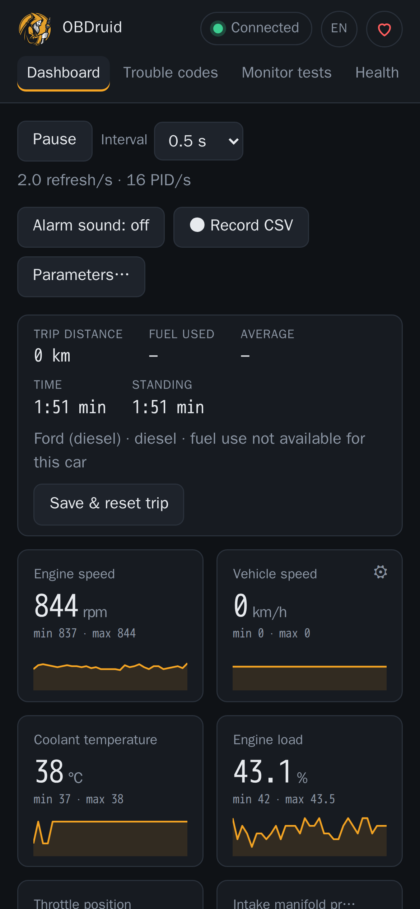

# OBD Tool

A small OBD-II workshop tool in Python: live data, reading and clearing trouble codes,
readiness monitors. One core, three front ends:

- **CLI** – `obd-tool info | live | dtc | clear | pids | ports`
- **Web UI** – `obd-tool web`, open it from a laptop or a phone
- **Desktop GUI** – `obd-tool gui`, the same UI in a native window (pywebview)

A built-in **ELM327 simulator** (`--sim`) lets you run everything without a car.


| Trouble codes | Vehicle info | Phone |
|---|---|---|
|  |  |  |

## Tested hardware

- Adapter: Vgate **vLinker FS** USB (FTDI, ELM327 v2.3 compatible), 115200 baud
- Car: petrol engine, ISO 15765-4 CAN 11 bit / 500 kbit, single engine ECU (7E8)
- Host: Orange Pi 3B, Debian 12 (aarch64), Python 3.11; also any Linux PC

Any ELM327 compatible adapter (USB, Bluetooth via `rfcomm`) should work through
[python-OBD](https://github.com/brendan-w/python-OBD).

## Install

```bash
git clone git@github.com:spidero/obd-II-python.git
cd obd-II-python
python3 -m venv --system-site-packages .venv
.venv/bin/pip install -e ".[gui]"        # or ".[web]" without the desktop window
```

System packages (Debian/Ubuntu):

```bash
sudo apt install python3-venv                       # virtual environments
sudo apt install python3-gi gir1.2-gtk-3.0 gir1.2-webkit2-4.1   # only for `obd-tool gui`
sudo usermod -aG dialout $USER                      # access to /dev/ttyUSB*, log in again
```

`--system-site-packages` is needed for the GUI because the GTK bindings (`gi`) come from
the system, not from pip. Without them `obd-tool gui` falls back to the web browser.

## Usage

```bash
obd-tool ports                       # find the adapter
obd-tool -p /dev/ttyUSB0 info        # adapter, protocol, VIN, MIL, readiness monitors
obd-tool -p /dev/ttyUSB0 live        # live data (Ctrl+C to stop)
obd-tool live RPM SPEED COOLANT_TEMP -i 0.25 --csv drive.csv
obd-tool pids                        # parameters supported by the car
obd-tool dtc                         # stored and pending trouble codes
obd-tool clear                       # clear codes (asks for confirmation)
obd-tool web                         # web UI on http://localhost:8090
obd-tool web --host 0.0.0.0          # ...reachable from the local network
obd-tool gui                         # desktop window
obd-tool --sim live                  # anything above, against the simulator
```

Options can also be set with environment variables: `OBD_PORT`, `OBD_BAUD`,
`OBD_PROTOCOL`, `OBD_SIM=1`, `OBD_WEB_HOST`, `OBD_WEB_PORT`.
Use the stable `/dev/serial/by-id/...` path instead of `/dev/ttyUSB0` when possible.

### Clearing trouble codes

Clearing (mode 04) erases stored and pending codes and freeze frame data **and resets
the readiness monitors**. Until they complete again (a few drive cycles) the car may fail
an emissions inspection. The CLI asks for confirmation (`--yes` skips it), the web UI
requires ticking a checkbox, and the API refuses requests without `"confirm": true`.

### Web API

| Method | Path | Description |
|---|---|---|
| GET | `/api/state` | connection state |
| POST | `/api/connect` | `{"port", "baudrate", "protocol", "simulate"}` |
| POST | `/api/disconnect` | |
| GET | `/api/ports` | serial ports |
| GET | `/api/info` | adapter, VIN, MIL, readiness |
| GET | `/api/params` | supported live parameters |
| GET | `/api/read?keys=RPM,SPEED` | one-shot read |
| GET | `/api/dtc` | stored + pending codes |
| POST | `/api/dtc/clear` | `{"confirm": true}` |
| WS | `/ws/live` | send `{"keys": [...], "interval": 0.5}`, receive readings |

The web server has no authentication. Keep it on `127.0.0.1` (default) or a trusted
network.

### Run as a service (Raspberry/Orange Pi)

`deploy/obd-tool-web.service` starts the web UI on boot, listening on all interfaces:

```bash
sudo cp deploy/obd-tool-web.service /etc/systemd/system/
sudo systemctl enable --now obd-tool-web
```

## Development

```bash
.venv/bin/pip install -e ".[dev]"
.venv/bin/pytest
```

Without a local venv, run the tests in Docker:

```bash
docker run --rm -v "$PWD":/app -w /app python:3.12-slim \
  sh -c 'pip install -q -e ".[dev]" && pytest -q'
```

Layout:

```
src/obd_tool/
  core/session.py     thread-safe OBD session on top of python-OBD
  core/simulator.py   ELM327 emulator on a pseudo terminal
  core/pids.py        parameter catalogue (labels, units, groups)
  core/dtc.py         DTC encoding and descriptions
  cli.py              Typer CLI
  web/server.py       FastAPI + WebSocket
  web/static/         UI (plain HTML/CSS/JS, no CDN – works offline)
  gui.py              pywebview window
tests/                pytest, all against the simulator
```

## Roadmap

- Docker image + compose for the Orange Pi (adapter passed with `devices:`)
- MQTT publishing for Home Assistant
- Freeze frame (mode 02), permanent codes (mode 0A), mode 06 test results
