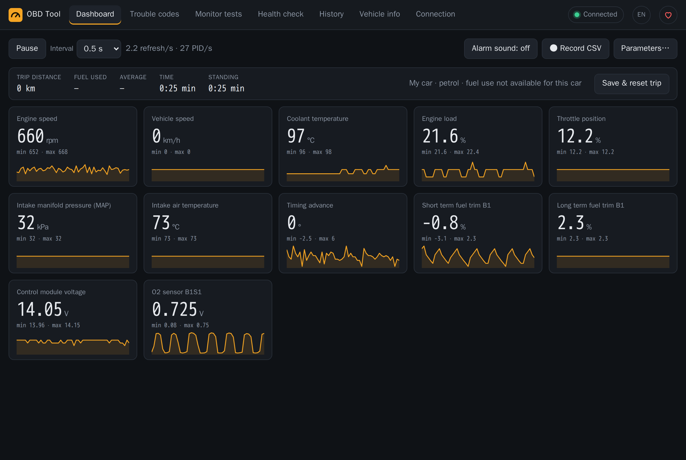
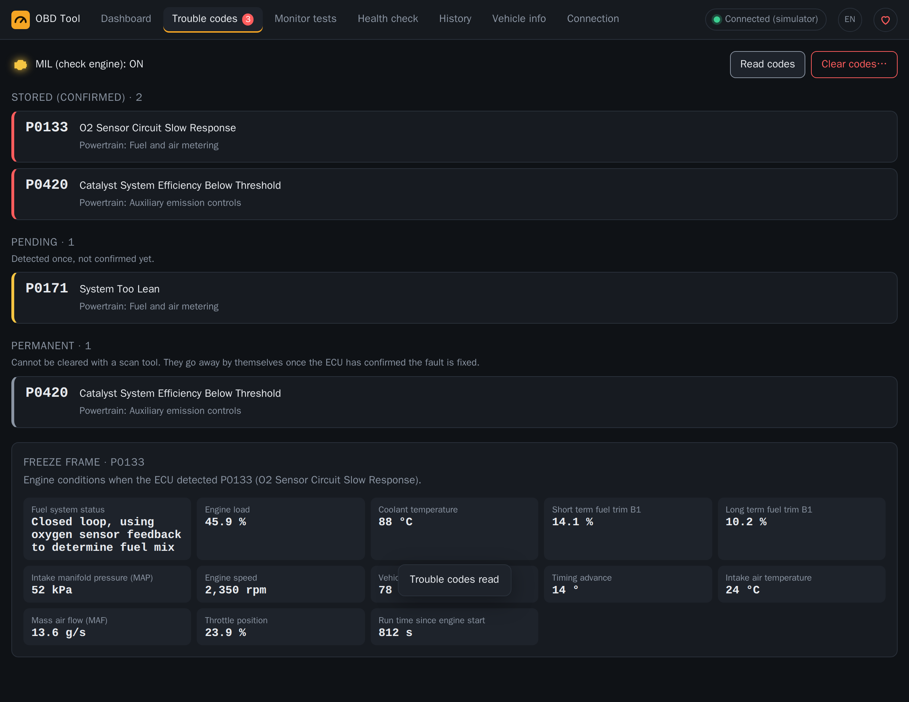
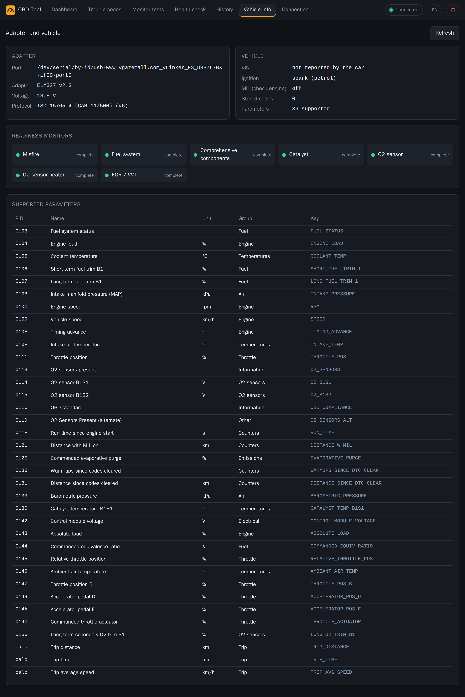
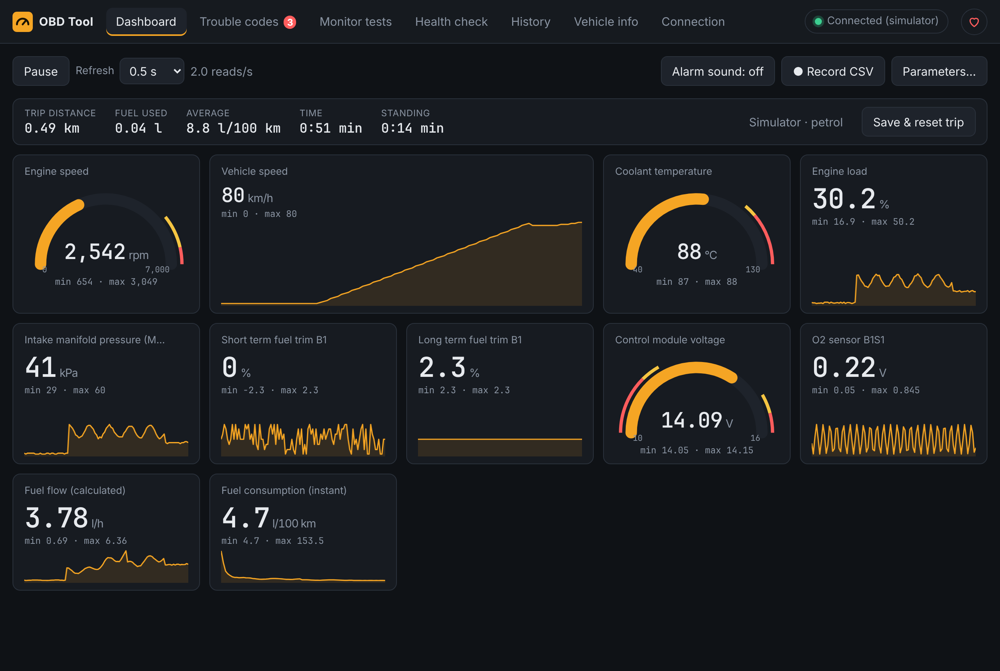
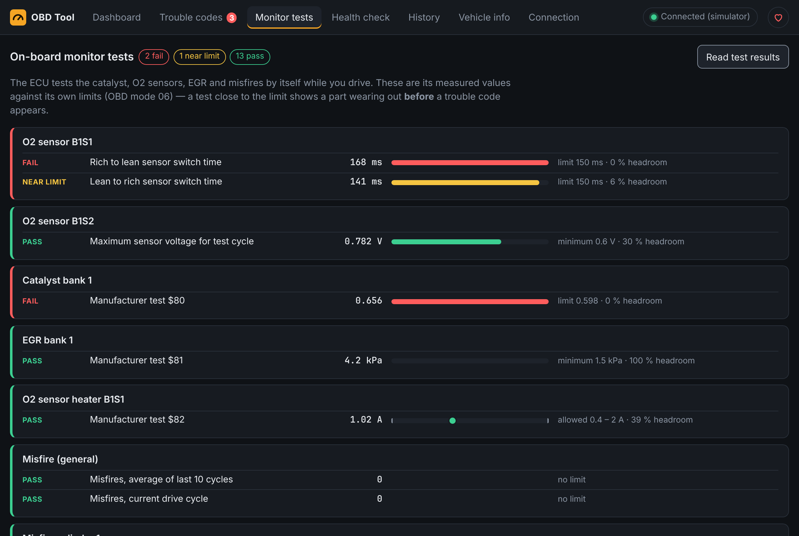
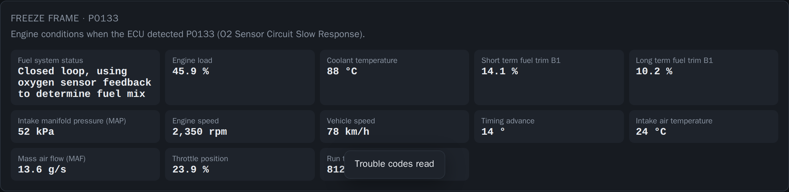
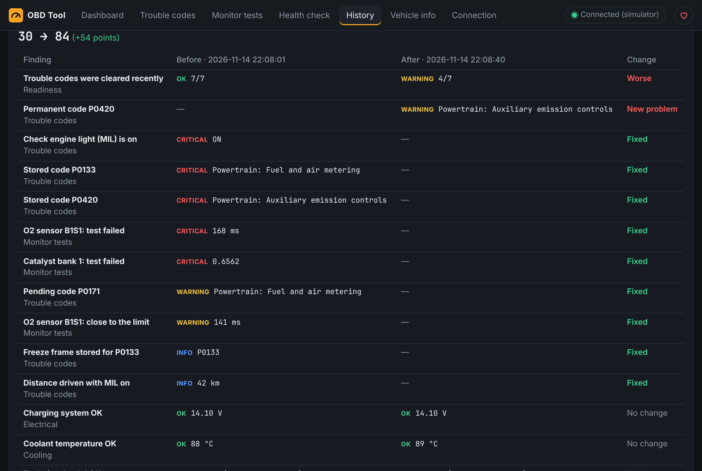

# OBD Tool

[](https://github.com/spidero/obd-II-python/actions/workflows/tests.yml)

_by Piotr Skwarna · GPL-2.0-or-later_

A small OBD-II workshop tool in Python: live data, reading and clearing trouble codes,
freeze frame, on-board monitor tests (mode 06), readiness monitors, fuel consumption and a
**vehicle health check** with a 0–100 score. One core, three front ends:

- **CLI** – `obd-tool info | live | dtc | tests | clear | health | history | pids | ports`
- **Web UI** – `obd-tool web`, open it from a laptop or a phone
- **Desktop GUI** – `obd-tool gui`, the same UI in a native window (pywebview)

The web UI and the desktop GUI are available in **English and Polish** – switch with the `EN`/`PL`
button in the top bar.

A built-in **ELM327 simulator** (`--sim`) lets you run everything without a car.



| Health check | Trouble codes | Vehicle info | Phone |
|---|---|---|---|
|  |  |  |  |

| Gauges and alarms | Monitor tests (mode 06) | Freeze frame | Before / after comparison |
|---|---|---|---|
|  |  |  |  |

## Supported adapters

| Adapter | Status | Notes |
|---|---|---|
| Vgate vLinker FS (USB) | **tested** | FTDI serial, ELM327 v2.3 compatible, 115200 baud. Reference adapter. |
| Other USB ELM327 / STN adapters (OBDLink SX/EX, vLinker FD/MC USB) | should work | Anything that shows up as a serial port and speaks the ELM327 command set. |
| Bluetooth Classic ELM327 (SPP) | should work | Pair it and bind a serial port first (Linux: `rfcomm`, Windows: COM port). Not tested yet. |
| Cheap ELM327 v1.5 / v2.1 clones | should work | Often unreliable or slow; try `--slow` if the connection fails. |
| Wi-Fi ELM327 adapters | not supported | They use a TCP socket instead of a serial port. |
| Bluetooth LE adapters (iOS style) | not supported | No serial port; needs a dedicated BLE transport. |

Cars: anything with a standard OBD-II / EOBD socket (petrol from about 2001, diesel from about
2004 in the EU). Only the engine ECU's generic emissions data is read – no ABS, airbag or
gearbox modules. Mode 06 needs a CAN protocol. The same table is shown in the Connection tab.

## Tested hardware

- Adapter: Vgate **vLinker FS** USB (FTDI, ELM327 v2.3 compatible), 115200 baud
- Car: petrol engine, ISO 15765-4 CAN 11 bit / 500 kbit, single engine ECU (7E8)
- Host: Orange Pi 3B, Debian 12 (aarch64), Python 3.11; also any Linux PC

Any ELM327 compatible adapter (USB, Bluetooth via `rfcomm`) should work through
[python-OBD](https://github.com/brendan-w/python-OBD).

## Install

```bash
git clone https://github.com/spidero/obd-II-python.git
cd obd-II-python
python3 -m venv --system-site-packages .venv
.venv/bin/pip install -e ".[gui]"        # or ".[web]" without the desktop window
```

System packages (Debian/Ubuntu):

```bash
sudo apt install python3-venv                       # virtual environments
sudo apt install python3-gi gir1.2-gtk-3.0 gir1.2-webkit2-4.1   # only for `obd-tool gui`
sudo usermod -aG dialout $USER                      # access to /dev/ttyUSB*, log in again
```

`--system-site-packages` is needed for the GUI because the GTK bindings (`gi`) come from
the system, not from pip. Without them `obd-tool gui` falls back to the web browser.

## Usage

```bash
obd-tool ports                       # find the adapter
obd-tool -p /dev/ttyUSB0 info        # adapter, protocol, VIN, MIL, readiness monitors
obd-tool -p /dev/ttyUSB0 live        # live data (Ctrl+C to stop)
obd-tool live RPM SPEED COOLANT_TEMP -i 0.25 --csv drive.csv
obd-tool pids                        # parameters supported by the car
obd-tool live RPM FUEL_FLOW FUEL_ECONOMY TRIP_DISTANCE   # calculated fuel use and trip values
obd-tool dtc                         # stored, pending and permanent codes + freeze frame
obd-tool dtc --json
obd-tool tests                       # on-board monitor test results (mode 06)
obd-tool clear                       # clear codes (asks for confirmation, saves a backup first)
obd-tool history                     # saved health reports, pre-clear backups and trips
obd-tool health                      # 30 s health check, score 0-100
obd-tool health -d 60 --html report.html --json
obd-tool web                         # web UI on http://localhost:8090
obd-tool web --host 0.0.0.0          # ...reachable from the local network
obd-tool gui                         # desktop window
obd-tool gui --remote raspberrypi.local   # desktop window showing another machine's web UI
obd-tool --sim live                  # anything above, against the simulator
```

Options can also be set with environment variables: `OBD_PORT`, `OBD_BAUD`,
`OBD_PROTOCOL`, `OBD_SIM=1`, `OBD_WEB_HOST`, `OBD_WEB_PORT`, `OBD_REMOTE`.
Use the stable `/dev/serial/by-id/...` path instead of `/dev/ttyUSB0` when possible.

### Desktop window for a remote adapter

When the adapter is plugged into another machine (for example a Raspberry/Orange Pi in the car
running `obd-tool web --host 0.0.0.0`), the desktop app can show that machine instead of starting
its own server:

```bash
obd-tool gui --remote 192.168.1.50          # http:// and port 8090 are added
obd-tool gui --remote https://obd.example.com/   # a full URL is used as is
```

The app checks that an OBD Tool server answers at the address before opening the window.

### Health check

Run it with the engine running, warm (>70 °C) and idling. The check reads trouble codes,
readiness monitors and counters, samples live data (the last third only the O2 sensors, at a
higher rate) and applies rules of thumb for petrol engines:

| Area | What is checked |
|---|---|
| Trouble codes | MIL, stored and pending codes, distance driven with MIL on |
| Readiness | incomplete monitors; few km / warm-ups since clearing = "codes cleared recently" |
| Electrical | charging voltage with the engine running (13.4–14.8 V), resting battery voltage |
| Cooling | overheating (>104 / >108 °C), thermostat stuck open (<75 °C after 15 min) |
| Fuel mixture | short + long term fuel trim per bank (±10 % warning, ±20 % critical) |
| Idle | rpm stability while standing, high idle, intake vacuum (MAP) at idle |
| O2 sensors | upstream sensor switching rate and amplitude |
| Catalyst | downstream sensor steady vs. following the upstream one |

Each finding is OK / info / warning / critical, or "not evaluated" when a precondition
(engine running, engine warm, car standing) is not met. The score starts at 100 and loses
points per finding; any critical finding caps it at 59 (Poor), any warning at 84 (Fair).
The report can be downloaded as HTML (printable) or JSON. It is an indicative check,
not a replacement for a workshop diagnosis.

Try it without a car using simulator faults:

```bash
obd-tool --sim --sim-no-codes health -d 15                       # healthy car
obd-tool --sim --sim-fault lean --sim-fault catalyst health -d 15
```

Faults: `lean`, `rich`, `charging`, `overheat`, `rough_idle`, `lazy_o2`, `catalyst`, `cleared`.

### Freeze frame, permanent codes and monitor tests

- **Freeze frame** (mode 02): the engine conditions the ECU recorded when it detected the fault –
  rpm, speed, load, coolant temperature, fuel trims. Most cars keep one frame, and clearing erases it.
- **Permanent codes** (mode 0A): confirmed codes that a scan tool cannot clear. They go away by
  themselves once the ECU has seen the fault fixed.
- **Monitor tests** (mode 06): the ECU's own test results for the catalyst, O2 sensors, EGR, misfire
  counters… with its limits. Each result is rated `pass`, `near limit` (less than 15 % headroom to a
  single limit, or within 10 % of the edge of an allowed window) or `fail`, so a part that is wearing
  out shows up before a trouble code does. Test names above `$80` are manufacturer defined and shown
  by number. The health check uses all three.

### Dashboard, fuel consumption and trips

Every tile can be a number with a history line, a gauge or a large chart, with its own scale and
warning/alarm limits (coloured tile, optional beep). Drag tiles to reorder them. The layout is stored
on the server per vehicle, so the phone and the laptop show the same dashboard.

Calculated parameters: fuel flow (l/h), instant and average consumption (l/100 km), trip distance,
fuel used, time and average speed. Fuel flow comes from the ECU's fuel rate (PID 5E) when the car
reports it, otherwise it is estimated from the mass air flow for petrol and LPG (set the fuel in the
vehicle profile). It is an estimate – a little high while coasting and at full load. Diesels need
PID 5E. “Save & reset trip” keeps the trip in the history.

### Vehicle profiles and history

Each vehicle has a profile (name, VIN, fuel, notes), its own dashboard layout and a history of health
reports, pre-clear backups and trips – see the History tab or `obd-tool history`. Cars that report a
VIN are recognised automatically; the simulator always uses its own “Simulator” profile. Tick two
health reports to compare them, for example before and after a repair. Files are plain JSON in
`~/.local/share/obd-tool` (override with `OBD_TOOL_DATA`).

### Languages

The `EN`/`PL` button in the top bar switches the web UI (and the printable health report) between
English and Polish; the choice is remembered in the browser, and a Polish browser starts in Polish.
English texts are the keys of one dictionary, `src/obd_tool/web/static/pl.json`, used by both the
browser and the server (`obd_tool/i18n.py`). Health findings are stored as templates with parameters,
so saved reports follow the current language. To add a language, copy `pl.json`, translate it and add
its code to `LANGUAGES` in `i18n.py` and to the button in `app.js`. Not translated: the command line,
the trouble code descriptions (they come from python-OBD's English database) and the API messages.

### Clearing trouble codes

Clearing (mode 04) erases stored and pending codes and freeze frame data **and resets
the readiness monitors**. Until they complete again (a few drive cycles) the car may fail
an emissions inspection. The CLI asks for confirmation (`--yes` skips it), the web UI
requires ticking a checkbox, and the API refuses requests without `"confirm": true`.
Before clearing, the codes and the freeze frame are saved to the vehicle history.

### Web API

| Method | Path | Description |
|---|---|---|
| GET | `/api/state` | connection state |
| POST | `/api/connect` | `{"port", "baudrate", "protocol", "simulate"}` |
| POST | `/api/disconnect` | |
| GET | `/api/ports` | serial ports |
| GET | `/api/info` | adapter, VIN, MIL, readiness |
| GET | `/api/params` | supported live parameters |
| GET | `/api/read?keys=RPM,SPEED` | one-shot read |
| GET | `/api/dtc` | stored, pending and permanent codes + freeze frame |
| GET | `/api/freeze-frame` | freeze frame (mode 02) |
| GET | `/api/monitors` | monitor test results (mode 06) |
| POST | `/api/dtc/clear` | `{"confirm": true}`; saves a backup to the history first |
| GET, PUT | `/api/dashboard` | dashboard layout of the active vehicle |
| GET | `/api/trip` | trip summary; `POST /api/trip/reset` saves and resets it |
| GET, POST | `/api/vehicles` | vehicle profiles; `PUT`/`DELETE /api/vehicles/{id}`, `POST .../activate` |
| GET | `/api/history` | history records (`?kind=health\|dtc-backup\|trip`); `GET`/`DELETE /api/history/{id}`, `GET .../report.html` |
| GET | `/api/about` | version, links, supported adapters |
| WS | `/ws/health` | send `{"duration": 30}`, receive progress and the report |
| GET | `/api/health/last` | last health report (JSON) |
| GET | `/api/health/report.html` | last health report (HTML, `?download=1`) |
| WS | `/ws/live` | send `{"keys": [...], "interval": 0.5}`, receive readings |

The web server has no authentication. Keep it on `127.0.0.1` (default) or a trusted
network.

### Run as a service (Raspberry/Orange Pi)

`deploy/obd-tool-web.service` starts the web UI on boot, listening on all interfaces. It is an
example for the user `pi` with the repo in `/home/pi/obd-II-python` – edit `User`, the paths and
optionally `OBD_PORT` first:

```bash
sudo cp deploy/obd-tool-web.service /etc/systemd/system/
sudo systemctl enable --now obd-tool-web
```

## Development

```bash
.venv/bin/pip install -e ".[dev]"
.venv/bin/pytest
```

Without a local venv, run the tests in Docker:

```bash
docker run --rm -v "$PWD":/app -w /app python:3.12-slim \
  sh -c 'pip install -q -e ".[dev]" && pytest -q'
```

Layout:

```
src/obd_tool/
  core/session.py     thread-safe OBD session on top of python-OBD
  core/simulator.py   ELM327 emulator on a pseudo terminal
  core/pids.py        parameter catalogue (labels, units, groups)
  core/dtc.py         DTC encoding and descriptions
  core/diag.py        freeze frame (02), monitor tests (06), permanent codes (0A)
  core/trip.py        fuel consumption and trip computer
  core/storage.py     vehicle profiles, dashboard layouts, history (JSON files)
  core/health.py      health check: sampling + rules (pure evaluate())
  core/report_html.py printable HTML report
  about.py            project links, supported adapters
  i18n.py             translations shared with the browser (web/static/pl.json)
  cli.py              Typer CLI
  web/server.py       FastAPI + WebSocket
  web/static/         UI (plain HTML/CSS/JS, no CDN – works offline)
  gui.py              pywebview window
tests/                pytest, all against the simulator
```

## Roadmap

- Docker image + compose for the Orange Pi (adapter passed with `devices:`)
- MQTT publishing for Home Assistant
- Custom / manufacturer PIDs from a file
- Windows build, Bluetooth adapters

## Support

OBD Tool is free and open source. If it saved you a trip to the workshop, you can support its development:

- [GitHub Sponsors](https://github.com/sponsors/spidero)
- [PayPal](https://paypal.me/spidero)

A star on GitHub, a bug report or telling a friend help too.

## Contributing

Bug reports, car/adapter reports, translations and code are welcome – see
[CONTRIBUTING.md](CONTRIBUTING.md) and the [Code of Conduct](CODE_OF_CONDUCT.md).
Security problems: [SECURITY.md](SECURITY.md).

## License

Copyright (C) 2026 Piotr Skwarna

OBD Tool is free software: you can redistribute it and/or modify it under the terms of the
GNU General Public License as published by the Free Software Foundation, either
[version 2 of the License](LICENSE), or (at your option) any later version
(SPDX: `GPL-2.0-or-later`).

This program is distributed in the hope that it will be useful, but WITHOUT ANY WARRANTY;
without even the implied warranty of MERCHANTABILITY or FITNESS FOR A PARTICULAR PURPOSE.
See the GNU General Public License for more details.

OBD Tool uses [python-OBD](https://github.com/brendan-w/python-OBD) (GPL-2.0-only); bundled builds
that include it, such as a standalone Windows `.exe`, are therefore distributed under GPL version 2.
The other dependencies (pyserial, Typer, Rich, FastAPI, Uvicorn, pywebview) use MIT or BSD licenses.
